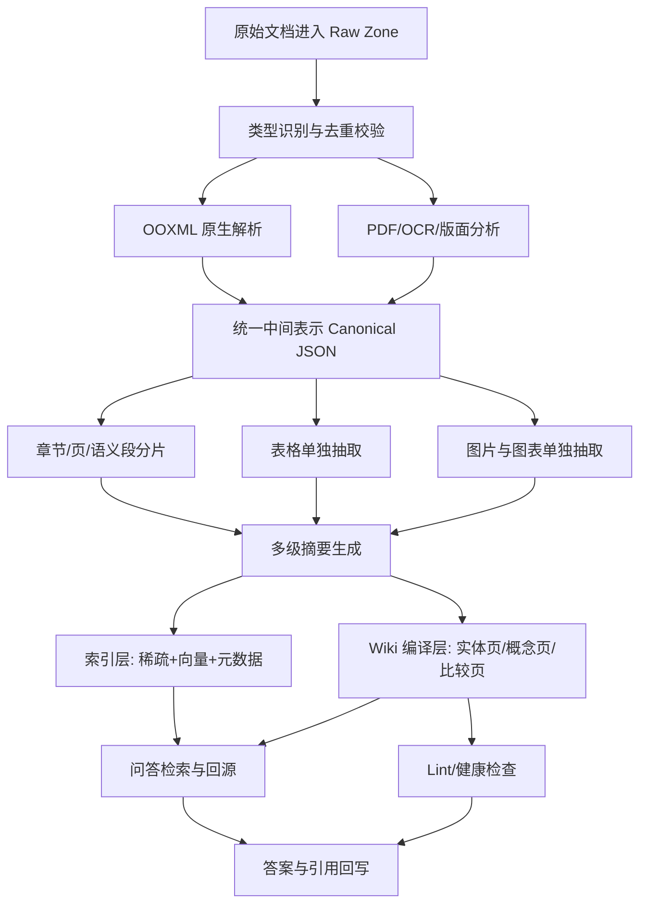
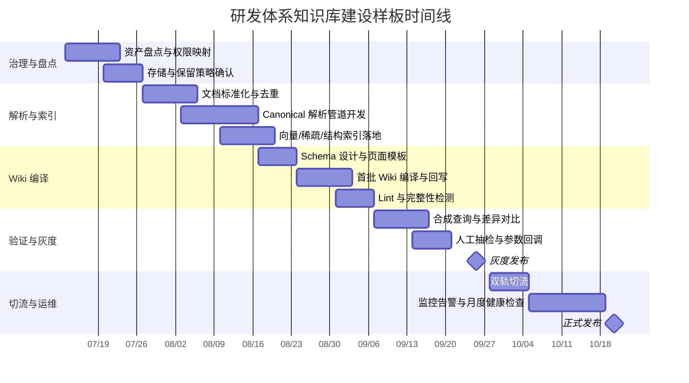

# 基于 Andrej Karpathy LLM Wiki 的研发体系知识库建设分析报告

## 执行摘要

本文将你提到的“卡帕西（Karpasi?）”明确按 **Andrej Karpathy** 理解，依据是他在 2026 年 4 月公开发布的 `LLM Wiki` Gist：这不是一个现成产品，而是一份“idea file”，用于指导 LLM 代理把原始资料编译成可持续维护的 Wiki。Karpathy 给出的核心结构是三层：**不可变原始资料层**、**由 LLM 维护的 Markdown Wiki 层**、以及约束工作流与命名规则的 **schema 层**。他强调的关键点不是“问答时再去原始文档里检索”，而是“导入时先把知识编译进 Wiki，后续问题尽量围绕这个持久化知识工件回答”。citeturn2view0turn8view2turn8view4

这与经典 RAG 的差异非常明确。原始 RAG 论文将其定义为把**参数化记忆**与**显式的非参数化记忆**结合起来，在查询阶段从外部索引中取回片段后生成答案；而 Karpathy 的 LLM Wiki 则把“知识沉淀”前置到导入阶段，把 Wiki 作为中间层和长期资产。前者更像“按需取片段”，后者更像“先编译、再查询”。这一差异决定了它们在企业研发知识库中的适用边界：**LLM Wiki 更强于持续综合、主题演化、跨文档对齐与知识复利；RAG 更强于大规模、高更新频率、强权限隔离、原文证据回溯**。citeturn8view0turn8view8turn8view4

对企业研发体系而言，**不建议字面照搬“纯 LLM Wiki、无检索基础设施”**。Karpathy 自己也明确写到，在“小到中等规模”时，一个 `index.md` 可能就够了；但 Wiki 继续增长后，就需要“proper search”，并提到了本地混合检索方案。对于公司级知识库，这意味着最稳妥的路线不是“纯 Wiki 取代 RAG”，而是 **“编译型 Wiki + 原始资料层 + 混合检索回退”** 的三层增强版：Wiki 负责高质量沉淀，RAG 负责大规模召回与原文兜底。citeturn8view4turn8view9

在大文件处理上，报告的关键建议是：**不要把“大文件可被长上下文模型一次读完”误解为“工程上应直接整篇塞进模型”**。Anthropic 对“上下文工程”的官方定义，就是在推理时持续维护“最优 token 集合”；其长上下文实验也说明，面对长文档，仍需专门策略来提高正确召回。换言之，长上下文能力并没有取消分片、分层摘要、父子索引、结构化提取这些工程手段，只是让它们可以更精细，而不是更粗暴。citeturn7view2turn7view3

因此，本文的总体结论是：**针对研发体系知识库，最佳落地方案不是“纯 LLM Wiki”或“纯 RAG”，而是“以 LLM Wiki 为编译层，以混合检索为回退层，以原始资料为审计层”的混合架构**。这样既符合 Karpathy 原始思路的“知识复利”目标，也满足企业环境对大文件、表格、PPT 图表、权限、版本和可验证性的要求。citeturn8view2turn8view4turn7view5

## 现状与输入假设

由于你没有提供现有系统的文件分布、存储位置、访问协议和典型文档规模，以下内容将把**未给定的信息明确标注为“未指定”**，并给出工程假设。此处的假设目的是形成可执行的设计输入，而不是替代你们的现网盘点。

### 当前已知输入与建议补全项

| 维度 | 当前已知状态 | 报告中的工作假设 | 备注 |
|---|---|---|---|
| 知识库建设目标 | 已知：研发体系知识库 | 以“研发规范、项目文档、技术方案、复盘、会议纪要、运营指标文档”为主 | 面向长期沉淀与检索问答 |
| 方法论来源 | 已知：Karpathy LLM Wiki | 按 Andrej Karpathy 2026-04-04 的 `LLM Wiki` 原始 Gist 理解 | 原始资料优先 |
| 文档类型 | 已知：Word、Excel、PPT、PDF、其他 | 扩展支持 Markdown、TXT、HTML、CSV、JSON、图片型扫描件、邮件导出 | 企业研发场景常见扩展 |
| 存储位置 | 未指定 | 原始资料位于对象存储/企业网盘/共享盘/知识平台任一组合；Wiki 与 schema 建议 Git 管理 | 现状需盘点 |
| 权限模型 | 未指定 | 最低要求为“文档级 ACL 继承到 chunk 与 wiki page” | 企业场景关键 |
| 更新频率 | 未指定 | 假设每日增量、每周批量整理、每月健康检查 | 便于排期 |
| 语言 | 已知：中文为主 | 兼容中英双语文档与术语混写 | 研发文档常见 |
| 质量要求 | 已知：分析严谨、可操作 | 默认要求可追溯、可回滚、可验证 | 适合公司落地 |

### 需支持的文档类型与接入方式

| 类型 | 建议支持格式 | 当前存储位置 | 首选解析方式 | 备注 |
|---|---|---|---|---|
| Word | `.docx`、`.doc` | 未指定 | `.docx` 走 Open XML 原生结构解析；`.doc` 先标准化转换为 `.docx` 或 PDF | Word 属于 Office Open XML 体系时可直接读取结构。citeturn7view4 |
| Excel | `.xlsx`、`.xls`、`.csv` | 未指定 | `.xlsx` 优先原生单元格、sheet、表对象解析；`.xls` 转 `.xlsx` | Excel 不应只抽全文文本，应保留工作表与单元格结构。citeturn7view4turn11view1 |
| PPT | `.pptx`、`.ppt` | 未指定 | `.pptx` 走 PresentationML，抽取 slide、shape、table、picture、notes；`.ppt` 转 `.pptx` | PPT 原生文本和结构可从 Open XML 包中读取。citeturn13view0turn7view7 |
| PDF | 文本型 PDF、扫描型 PDF | 未指定 | 文本层 + 布局分析 + OCR；表格和图像单独走结构化提取 | 需要页、段、表、图的多层定位。citeturn7view5turn9view2 |
| 其他 | `.md`、`.txt`、`.html`、`.json`、`.xml`、邮件导出、图像 | 未指定 | 文本直读；结构化文件保留字段；图片走 OCR/视觉摘要 | 属于二期但建议架构预留 |

### 大文件定义阈值建议

“**大文件**”建议同时按**二进制体积**、**提取后 token 量**、以及**文档内部结构规模**三种口径判断。原因是：文件字节大小并不等于 LLM 处理难度，而长上下文也不能替代 token 预算管理与上下文工程。Anthropic 官方把上下文工程定义为“维护最优 token 集合”，OpenAI 的检索指南也默认采用 chunking 而不是整文件直接索引。citeturn7view2turn7view0

| 口径 | 建议阈值 | 触发动作 | 理由 |
|---|---|---|---|
| 单次直读阈值 | `> 30k` 提取后 tokens | 禁止单轮整篇直读，强制进入分片/摘要模式 | 超过这一量级后，阅读成本、遗漏风险、断章风险明显上升；长上下文应服务于“整合”而不是“生吞” |
| 通用工程大文件阈值 | `> 50 MB` 或 `> 100k` 提取后 tokens | 进入异步编译管道 | 便于把“费时解析”和“交互问答”解耦 |
| Word/PDF | `> 300` 页或 `> 100k` tokens | 章节化 + 页级索引 + 多级摘要 | 研发手册、规章、白皮书常见 |
| PPT | `> 150` 页或 `> 60k` tokens | 按 slide 分治 + 图表单独抽取 | PPT 信息密度受版式影响更大 |
| Excel | `> 20` sheets、或 `> 200k` 非空单元格、或 `> 20 MB` | sheet 分片，表对象单独建索引 | Excel 的信息复杂度主要来自二维结构 |
| 图像/扫描件 | `> 500` 页等价图像 | OCR 分批 + 低置信度人工抽检 | 扫描件错误率高，必须有质检 |

这些阈值是**建议值**而非标准值，可在首轮试点后根据你们的平均文档长度、模型成本、SLA 和硬件条件再回调。它们的核心作用不是“限制可处理文件”，而是明确**什么时候必须进入编译型处理，而不能假装对话模型可以一次吞完**。citeturn7view3turn7view0

## LLM Wiki 原理与限制

### 原理概述

Karpathy 的 `LLM Wiki` 明确提出了三层结构。第一层是**原始资料**，它是“不可修改”的真实来源；第二层是**由 LLM 生成并维护的 Wiki**，用 Markdown 文件表现摘要、实体页、概念页、比较页和综合页；第三层是**schema 文件**，例如 `CLAUDE.md` 或 `AGENTS.md`，它告诉代理如何导入、回答、维护与命名。这意味着 LLM Wiki 的本质不是“一个检索器”，而是“一个知识编译器 + 维护器”。citeturn8view2turn8view4turn8view5

Karpathy 对核心差异的说明也很直接：普通文档问答往往是 RAG，问题来了再去原始文件里找相关片段；而 LLM Wiki 的做法是，当加入新资料时，LLM 会读它、抽取关键信息、更新已有页面、记录冲突、强化或修正综合结论。也就是说，知识不是每次回答现场拼出来，而是在导入时就被编译进 Wiki，并持续保持最新。citeturn2view0turn8view8

### 与 RAG 的关键区别

原始 RAG 论文把 RAG 定义为同时利用参数化记忆与非参数化记忆，在查询阶段访问外部索引来支撑生成。Karpathy 的 LLM Wiki 则把“外部显式知识”组织成可长期演进的 Wiki 工件。两者不是简单替代关系，而是**时间位置不同**：RAG 把主要工作放在**查询时**，LLM Wiki 把主要工作放在**导入时与维护时**。citeturn8view0turn8view8

| 维度 | 经典 RAG | Karpathy LLM Wiki | 对企业研发知识库的含义 |
|---|---|---|---|
| 主工作时机 | 查询时检索与拼装 | 导入时编译、查询时读取 Wiki | Wiki 适合“沉淀型知识”，RAG 适合“即时证据型问题” |
| 持久化资产 | 向量索引/倒排索引为主 | Markdown Wiki 为主 | Wiki 更适合作为长期资产与评审对象 |
| 证据来源 | 多为原始 chunk | 优先 Wiki 页，必要时回源原文 | 企业场景建议保留回源能力 |
| 更新方式 | 重新切片与重新索引 | 更新受影响页面、补链接、记冲突、跑 health check | 更适合形成知识演化轨迹 |
| 小规模实现 | 常依赖向量库 | Karpathy 认为可先靠 index.md | 公司规模通常会超出“只靠 index”的舒适区 |
| 大规模实现 | 检索系统天然适配 | 需要引入搜索引擎/混合检索 | 企业实际更适合混合方案 |

上表的判断依据来自 Karpathy 原始 Gist 对“持久化 Wiki、index/log、moderate scale、以后要 proper search”的描述，以及 RAG 原始论文对“参数化+非参数化记忆”的界定。citeturn8view0turn8view4turn8view9

### 一次性读取大文件的限制

LLM Wiki 的理念虽然强调“导入时完整阅读并编译”，但不应被误读为“一个超长文件可以稳定地一轮读透并保真”。Anthropic 官方把上下文工程定义为在推理时“策划并维护最优 token 集合”，这本身就说明：**上下文不是越长越好，而是越合适越好**。Anthropic 的长上下文实验也明确是在研究如何“最大化模型从长文中正确回忆指定信息的概率”，这反过来说明，长上下文并不自动等于可靠召回。citeturn7view2turn7view3

因此，LLM Wiki 在企业大文件场景下的真实限制主要有四类。第一类是**上下文预算限制**，整篇直读会压缩问题上下文、系统规则和回写指令空间。第二类是**跨页/跨表结构丢失**，尤其是 PDF、扫描件、复杂 PPT 与 Excel。第三类是**维护成本上升**，因为一次导入会触发多页更新，而 Karpathy 自己也写到，一个来源可能影响 10 到 15 个 Wiki 页面。第四类是**规模转折点**：在中小规模可依赖 `index.md`，但规模变大后必须引入更正式的搜索与索引能力。citeturn8view4turn8view6

### 分片、索引、向量化与检索流程

Karpathy 的原型模式里，`index.md` 是内容导向目录，`log.md` 是时间导向日志；在回答查询时，LLM 先读 index，再钻取相关页面。这在约百个 sources、数百页 Wiki 的“中等规模”可用，而且能避免一上来就搭向量数据库。但他同样明确提到，随着 Wiki 增长，应该加入“proper search”，并提到本地混合检索。citeturn8view4

对公司级研发知识库，我建议把这一路径工程化为四段。首先是**原始文档解析与结构切分**；其次是**多级摘要与 Wiki 编译**；再次是**双层检索**，即 Wiki 页优先检索，原始片段作为回退；最后是**答案回写与健康检查**。向量化不是无条件必需，但在企业规模下非常有价值。OpenAI 官方检索文档默认就把文件拆成 `800` token、`400` overlap 的 chunk 进入向量存储，说明即便在官方“检索产品”中，chunking 仍是默认前提而不是可选项。OpenAI 的 embeddings 文档则把 embedding 定义为把文本转成数字向量用于搜索与聚类。citeturn7view0turn7view1

## 大文件处理方案设计

### 总体架构建议

对你们这种“基于 LLM Wiki 构建研发体系知识库”的目标，建议采用下面这套混合式编译管道：**原始资料不可变保存；各类文件先解析成统一中间表示；按章节、页、语义段、表格、图片/图表分别切分；生成 chunk、section、document 三层摘要；把结构化元数据与向量索引一起写入检索层；再由 LLM 把关键知识编译进 Wiki；最后对 Wiki 跑 lint 与完整性检查。** 这套结构既保留 Karpathy 的“compounding artifact”，也避免企业场景里把所有责任压在 Markdown Wiki 本身。citeturn8view2turn8view4turn7view5



### 分片策略

企业文档真正的难点不是“文本多”，而是“**结构异质**”。因此分片策略不能只按固定 token 长度切。建议把分片分成五类：**章节块、页块、语义段块、表格块、图像/图表块**。其中，章节块负责主题边界；页块负责 PDF 与 PPT 的空间定位；语义段块负责召回粒度；表格块负责结构化证据；图像/图表块负责非文本关键信息。Azure Document Intelligence 的 layout 模型能够输出段落、标题、节、表格、图像、选择标记和层级结构；这正适合先做结构识别，再做分片。citeturn9view1turn9view2turn9view4

建议参数如下表。表中数值是企业研发知识库的**一版默认值**，后续应通过验证集回调，不应视为固定标准。

| 对象 | 首选边界 | 目标片段大小 | 最大大小 | 重叠建议 | 备注 |
|---|---|---:|---:|---:|---|
| 纯文本章节块 | `title/sectionHeading` + 段落 | 600–900 tokens | 1200 tokens | 10%–15% | 用于设计文档、规范、报告 |
| 语义段块 | 相邻段落语义相近 | 300–500 tokens | 700 tokens | 15%–20% | 用于提高召回精度 |
| PDF 页块 | 页为主，章节为辅 | 1 页 | 2 页 | 上下页摘要桥接 | 适合回溯引用 |
| 表格块 | 一表一块 | 标题+表头+表体 | 按逻辑子表拆分 | 重复表头 | 大表按分组或分页拆 |
| PPT slide 块 | 一页 slide 一块 | slide 文本 + notes | 若 >700 tokens 则拆 shape 群组 | 不强制 overlap | PPT 的视觉结构比 token 更重要 |
| 图像/图表块 | 一图一块 | 80–200 token 描述 | 300 tokens | 无 | 必须挂靠页码/slide/标题 |

一个经验性原则是：**chunk 的目标不是“让它尽量短”，而是“让它既可独立理解，又不丢失父级结构”**。因此每个叶子 chunk 都应保存 `parent_section_id`、`page_no/slide_no`、`doc_id`、`table_id/figure_id`、`acl_id` 等父级元数据，检索时先召回叶子，再自动扩展其父块。这样能显著降低“断章率”。citeturn9view4turn8view4

### 元数据抽取规范

建议所有文档在进入索引前先被统一抽象成 `CanonicalDocument`。最少元数据字段应包含：`doc_id`、`source_uri`、`mime_type`、`checksum`、`title`、`authors`、`owner_dept`、`created_at`、`updated_at`、`version`、`language`、`security_level`、`acl_tags`、`topics`、`keywords`、`entities`、`tables[]`、`figures[]`、`sections[]`、`citations[]`、`origin_parser`、`parser_confidence`。

其中 `topics` 与 `keywords` 建议双路生成：一路来自规则与统计特征，另一路来自 LLM 归纳；两路不一致时保留冲突标记而不是覆盖。Karpathy 的 lint 思路本身就包含“检查冲突、陈旧主张、孤儿页、漏建页面、漏链接和数据缺口”，这套机制非常适合扩展成元数据质量校验。citeturn8view6

### 表格与 PPT 图表的结构化抽取

表格不应被当成普通文本段落。Azure Document Intelligence 的 layout 模型可以输出表格行列、跨行跨列、单元格边界与表头信息；在 PDF/扫描件场景下，PubTables-1M 论文表明，基于该数据集训练的 transformer 检测模型在表格检测、结构识别和功能分析上表现优秀，非常适合作为复杂 PDF 表格恢复的技术基线。citeturn7view5turn8view1

对 Office 文件，优先走**原生结构**而不是 OCR。Microsoft Open XML SDK 官方文档明确说明它支持 Word、Excel、PowerPoint 这三类 Office 文档，且以强类型对象和对 Open XML 包的操作为核心。对于 PPT，PresentationML 文档不是一个大 XML，而是多个 part；slide、picture、table 等都是独立部件。对于图表，Open XML 中 `c:chart` 和 `c:externalData` 明确表示图表及其与底层数据的关系；`externalData` 的官方说明指出，图表的数据既可以链接到外部 spreadsheet，也可以嵌入在同一个 XML package 里，保存为 embedded Spreadsheet object。换句话说，**原生 Office 图表完全有机会不靠视觉识别，而是直接回收其底层数据表与图表类型**。citeturn7view4turn13view0turn11view0turn7view8

具体建议如下表。

| 场景 | 首选方法 | 回退方法 | 产出结构 |
|---|---|---|---|
| Excel 表格 | 直接读取 sheet、range、header、formula、merged cells | 无 | `table_json` + `cell_matrix` + `formula_refs` |
| DOCX 表格 | 直接读取 table/row/cell | 若格式损坏则转 PDF 再识别 | `table_json` + 上下文标题 |
| PDF 文本表格 | Layout + 表格结构识别 | TATR/PubTables 路径 | HTML 表 + CSV + 单元格边界 |
| PPT 原生图表 | 读取 `c:chart` 与 `externalData` 指向的数据 | 若失效则转 OCR/vision | `chart_type` + `series` + `categories` + `source_range` |
| PPT 图片型图表 | 图片裁切 + vision 摘要 + 文本 OCR | 人工抽检 | `chart_summary` + `ocr_text` + 置信度 |
| PPT 普通图像 | 读取 picture part + OCR/vision 描述 | 无 | `figure_summary` + caption + 位置 |

需要特别注意一个官方限制：Azure Document Intelligence 对 Word、Excel、PowerPoint、HTML 的 layout 提取，当前是“抽取所有嵌入文本”，但**embedded images 不支持**。这意味着在 Office 文件里，如果你只依赖 layout API，会漏掉图片与部分图表语义，所以企业方案必须走 **“原生 OOXML 提取 + 图像单独送视觉模型”** 的双通路。citeturn9view0

### 多级摘要与索引策略

建议构造三层摘要。第一层是 **chunk 摘要**，长度 40–120 tokens，作用是快速判断 relevancy；第二层是 **section 摘要**，长度 100–250 tokens，作用是父块扩展；第三层是 **document 摘要**，长度 300–800 tokens，作用是目录页、Wiki 概览页和合成查询生成。Karpathy 的思路里，Wiki 的价值就在于已经存在的综合页、比较页、实体页和概念页；而你的企业方案应把这些页面看成**第三级乃至第四级摘要与综合工件**。citeturn8view4turn8view7

索引建议采用“四路并行”：

| 索引类型 | 内容 | 用途 |
|---|---|---|
| 稀疏索引 | 标题、术语、缩写、产品名、版本号、错误码 | 精确召回 |
| 向量索引 | chunk、section、document 摘要 + 正文 embedding | 语义召回 |
| 结构索引 | `doc -> section -> chunk -> table/figure` | 父子扩展 |
| Wiki 索引 | `index.md`、页面 frontmatter、实体/概念反链 | 利用 Karpathy 模式的“编译资产” |

对 embedding，建议以**中英双语表现稳定**的模型为主。如果走 OpenAI 路线，可把 `text-embedding-3-large` 作为主索引，高精度场景优先；把 `text-embedding-3-small` 作为历史档、冷数据或成本敏感分区。OpenAI 官方说明这两款是新的 embedding 模型，具备更高的多语言性能与可调向量维度。citeturn7view1

### 可复用算法与伪代码

下面给出一个适合工程落地的“统一编译算法”。它既适用于 LLM Wiki，也适用于你们后续接入混合检索。

```python
def compile_document_to_wiki(doc_file, acl, parser_cfg, llm, embedder):
    # 1) 识别类型与校验
    doc = detect_type_and_hash(doc_file)
    if is_duplicate(doc.checksum):
        return mark_skipped(doc, reason="duplicate")

    # 2) 解析为统一中间表示
    if doc.type in ["docx", "xlsx", "pptx"]:
        canonical = parse_ooxml(doc_file)          # 保留标题、段落、sheet、slide、table、picture、chart
    elif doc.type in ["pdf", "scan_pdf", "image"]:
        canonical = parse_layout_ocr(doc_file)     # 页、段、表、图、段落角色、sections
    else:
        canonical = parse_plain_or_structured(doc_file)

    # 3) 元数据抽取
    meta = extract_metadata(
        canonical,
        fields=["title", "authors", "date", "version", "topics", "entities", "security_level"]
    )
    meta["acl"] = acl
    meta["parser_confidence"] = estimate_parse_confidence(canonical)

    # 4) 结构化对象单独抽取
    tables = extract_tables(canonical)             # HTML/CSV/cell_matrix
    figures = extract_figures(canonical)           # OCR + vision summary
    charts = extract_native_or_visual_charts(canonical)

    # 5) 分片
    chunks = []
    chunks += chunk_by_sections(canonical, target=800, max_size=1200, overlap=120)
    chunks += chunk_tables(tables, repeat_headers=True, max_cells=200)
    chunks += chunk_slides(canonical, target=500, split_dense_slide=True)
    chunks += chunk_figures(figures, summary_tokens=120)

    # 6) 多级摘要
    for ch in chunks:
        ch.summary = llm.summarize(ch.text, mode="chunk")
    sections = build_parent_sections(chunks)
    for sec in sections:
        sec.summary = llm.summarize(sec.concat(), mode="section")
    doc_summary = llm.summarize_document(canonical, sections, tables, figures)

    # 7) 索引
    leaf_vectors = embedder.embed([ch.summary + "\n" + ch.text for ch in chunks])
    parent_vectors = embedder.embed([sec.summary for sec in sections] + [doc_summary])
    write_sparse_index(meta, chunks, sections)
    write_vector_index(meta, chunks, sections, leaf_vectors, parent_vectors)

    # 8) Wiki 编译
    wiki_delta = llm.compile_to_wiki(
        doc_summary=doc_summary,
        sections=sections,
        key_entities=meta["entities"],
        contradictions=find_local_conflicts(doc, existing_wiki=True),
        mode="entity_concept_comparison_pages"
    )
    apply_wiki_patch(wiki_delta)

    # 9) 健康检查
    lint_result = llm.health_check_wiki(
        checks=["contradiction", "staleness", "orphan_page", "missing_link", "missing_entity_page"]
    )

    # 10) 审计记录
    log_ingest(doc, meta, chunk_count=len(chunks), lint=lint_result)
    return success(doc.id)
```

这套伪代码的关键思想与 Karpathy 的原始工作流一致：**ingest、query、lint** 是三种核心操作；只是企业版本需要在 ingest 内部加入更强的结构化解析、多级索引和权限控制。citeturn8view4turn8view6

## 验证与完整性检测

### 指标体系定义

如果你们把研发体系知识库当作“生产系统”，那么“能回答一些问题”远远不够，必须对**覆盖、召回、支持度、一致性、断章、信息丢失**建立量化指标。Karpathy 的原始 Gist 已经强调定期 health-check Wiki，检查冲突、陈旧页面、孤儿页和数据缺口；企业落地应把它系统化为可追踪 KPI。citeturn8view6

建议指标如下：

| 指标 | 定义 | 推荐目标 |
|---|---|---:|
| 覆盖率 | 已进入 Canonical JSON 的源文档数 / 应接入文档总数 | ≥ 98% |
| 解析成功率 | 成功抽取结构与正文的文档数 / 已接入文档数 | ≥ 99% |
| 检索召回率 Recall@K | 金标准证据被前 K 个结果命中的比例 | `Recall@10 ≥ 0.90` |
| 支持精度 | 回答中的关键断言有可回溯证据的比例 | ≥ 95% |
| 答案一致性 | 同题多次运行语义一致且引文不冲突的比例 | ≥ 85% |
| 断章率 | 被引用 chunk 缺少父级上下文而导致误解的比例 | ≤ 8% |
| 信息丢失率 | 源文中的关键事实未进入 Wiki/索引的比例 | ≤ 3% |
| 冲突检出率 | 已知矛盾样本中被 lint 或回溯校验抓出的比例 | ≥ 90% |
| ACL 泄漏率 | 越权用户能取到不应访问片段的比例 | 0 |
| 新鲜度时延 | 文档更新到 Wiki/索引可见的延迟 | P95 ≤ 24h |

其中“断章率”建议定义为：  
`断章率 = 因缺失父级 section/page/table header 而导致答案偏义的引用数 / 总引用数`

“信息丢失率”建议定义为：  
`信息丢失率 = 人工或合成金标准中的关键事实漏收录数 / 关键事实总数`

### 自动化检测流程

自动化检测建议采用“四合一”流程：**合成查询、回溯验证、差异化比对、抽样人工审查**。这四步分别覆盖“系统会不会答”“答案有没有证据”“Wiki 编译是否比原始 RAG 丢信息”“人工是否认可”。citeturn8view6turn8view7

第一步是**合成查询**。基于 document summary、section summary、表格和图表对象自动生成问题集，问题类型至少覆盖：事实查找、跨文档比较、版本变化、表格问答、反例查找、时间线总结、术语解释、决策依据回溯。这样能在无大量人工标注的情况下，先建立一套回归测试题库。

第二步是**回溯验证**。所有回答都必须输出 `source_doc_id + page/slide + chunk_id + wiki_page_id`。系统随后自动检查：答案中的关键断言是否都能在 cited evidence 中找到支持；如果 chunk 过短，是否自动扩展到 parent section 后支持度变高。这个流程能直接量化“支持精度”和“断章率”。

第三步是**差异化比对**。同一问题分别走 `Wiki-first` 与 `Raw-RAG-first` 两套链路。如果 Wiki 答案缺失关键事实，而 Raw-RAG 能命中，则判定为“编译丢失”；反之，如果 Raw-RAG 片段嘈杂而 Wiki 更完整，则说明编译层发挥了复利价值。这个步骤本质上是在判断“你们是否真的从 RAG 升级到了更好的知识系统”，而不是只是多做了一层摘要。

第四步是**抽样人工审查**。建议每周以分层抽样方式人工检查：新导入大文件、低置信 OCR 扫描件、表格密集文档、图表密集 PPT、权限敏感文档，每类至少抽样 20 份。人工审查结果既用于复核，也用于修正 chunk 参数与 parser 路由。

### 测试用例模板

| 用例 ID | 文档类型 | 问题类型 | 输入问题 | 期望证据 | 期望答案特征 | 通过标准 |
|---|---|---|---|---|---|---|
| QA-PDF-001 | PDF 规范文档 | 事实查找 | 某安全规范对发布审批的要求是什么 | 页码、章节号、原文段落 | 明确列出要求并附引用 | 证据齐全，答案无歧义 |
| QA-PPT-002 | PPT 方案汇报 | 图表解释 | 该季度性能瓶颈主要来自哪一模块 | slide 图表 + 备注 | 能解释趋势且指出数据来源 | 图表结构提取成功 |
| QA-XLSX-003 | Excel 指标表 | 数值对比 | 近三个版本故障率变化趋势如何 | sheet、行列位置、公式来源 | 给出趋势与绝对值 | 数字与原表一致 |
| QA-DOCX-004 | Word 设计文档 | 跨章节综合 | 方案 A 与 B 的主要取舍是什么 | 两个 section + 比较页 | 输出比较表 | 两边证据均存在 |
| QA-MIX-005 | 多文档 | 时间线总结 | 某项目从立项到上线的重要节点是什么 | 会议纪要 + 方案 + 周报 | 时间线完整 | 至少 3 个来源交叉支持 |

### 评估表模板

| 日期 | 数据集版本 | 问题集规模 | Coverage | Recall@10 | 支持精度 | 一致性 | 断章率 | 信息丢失率 | ACL 泄漏 | 结论 |
|---|---|---:|---:|---:|---:|---:|---:|---:|---:|---|
| 2026-08-15 | v0.3 | 300 | 97.8% | 0.86 | 0.91 | 0.80 | 0.12 | 0.06 | 0 | 未达发布线 |
| 2026-09-05 | v0.6 | 600 | 99.1% | 0.92 | 0.96 | 0.88 | 0.06 | 0.025 | 0 | 可灰度发布 |

## 实施计划与运维

### 迁移步骤与数据管道

迁移建议分为六个阶段。首先做**资产盘点与权限映射**，把文档源、类型、更新频率、责任人和 ACL 梳理清楚。其次做**标准化与去重**，尤其是 `.doc/.xls/.ppt` 到 OOXML/PDF 的统一转换。然后落地**Canonical 解析与索引管道**，再在小范围试点中生成第一批 Wiki 页面。试点通过后，再做**双轨运行**：一条走 Wiki-first，一条走 Raw-RAG-first，用差异化比对压缩风险。最后是**切流上线**与**月度 health-check 常态化**。Karpathy 的工作流本身就包含 ingest、query、lint，企业化只是把它从“手工作坊”扩展成“可审计流水线”。citeturn8view4turn8view6

建议的上线样板时间线如下。为了避免相对时间歧义，以下时间线以 **2026-07-13** 作为项目启动假设日期。



### 关键里程碑

| 里程碑 | 目标日期 | 交付判定 |
|---|---|---|
| 资产盘点完成 | 2026-07-24 | 已形成来源清单、类型分布、权限模型、样本文档集 |
| 解析管道可用 | 2026-08-17 | Word/Excel/PPT/PDF 四类解析成功率达到试点目标 |
| 第一版索引与 Wiki | 2026-09-03 | 可从样本文档自动生成 chunk、summary、Wiki page |
| 验证集达标 | 2026-09-24 | Recall、支持精度、信息丢失率达到发布线 |
| 灰度发布 | 2026-09-25 | 指定部门可用，双轨对比稳定 |
| 正式发布 | 2026-10-20 | SLA、监控、权限、回滚、审计全部就绪 |

### 监控告警、版本管理、权限与合规

监控上，建议至少建立三层指标。第一层是**数据管道指标**，包括解析成功率、OCR 置信度、队列堆积、平均编译时延、embedding 失败率。第二层是**知识质量指标**，包括 orphan page 数、冲突页数、陈旧页比例、信息丢失率、断章率。第三层是**问答服务指标**，包括 Recall@K、支持精度、平均响应时延、回源率、ACL 拒绝率。Karpathy 的 lint 思路对第二层尤其关键，因为它天然能发现“知识库越来越大以后最容易被忽略的问题”。citeturn8view6

版本管理上，建议把**Raw Zone 与 Wiki Zone 分开管理**。Raw Zone 只允许 append/update 版本，不允许静默覆盖；Wiki Zone 则建议 Git 化，保留每次 ingest、query 回写、lint 修复的提交记录。Karpathy 的 `log.md` 是最小可行日志，但企业版本应进一步记录 `source checksum`、`parser version`、`embedding model/version`、`LLM model/version`、`schema version`、`ACL snapshot`，这样出错时才可复现实验与回滚。citeturn8view4turn8view5

权限与合规方面，不建议只做到“文档级权限”。因为 chunk、table、figure、wiki page 都可能被单独命中，所以 ACL 必须**从源文档继承到所有派生对象**。同时要建立删除传播机制：源文档下线、权限收紧、敏感级别修改时，派生 chunk、向量、Wiki 页面和缓存摘要都必须同步处理。此外，研发知识库通常还需要补充密钥扫描、PII 检测、审计日志和地域合规策略。这部分虽然不是 Karpathy 原始 Gist 的重点，但对企业内部系统是发布门槛。

### 性能优化建议

性能上，最重要的优化不是“换更快模型”，而是**减少不必要的全量重编译**。建议按 `checksum + structure_hash` 做增量更新：只有标题层级、表格内容、图表数据或正文发生变化时，才重算受影响 section 与 Wiki 页面。第二个优化点是**父子索引**：回答阶段先召回叶子 chunk，再按 parent section 自动扩展，避免直接把大 section 全量送模。第三个优化点是**冷热分层**：热文档保留细粒度 chunk 与父块双向量，历史档只保留 section/doc 级向量。第四个优化点是**摘要缓存**：document summary 和 section summary 尽量增量更新，不要每次全量重写。OpenAI 的官方检索与 embeddings 文档都说明，chunking 与向量化是基础设施级操作，应该被当成“长期维护的索引资产”，而不是临时消耗品。citeturn7view0turn7view1

## 输出物与交付物

### 交付清单

| 交付物 | 说明 | 形式 | 验收标准 |
|---|---|---|---|
| 总体方案文档 | 架构、流程、权限、索引、运维设计 | Markdown/PDF | 评审通过 |
| 数据字典 | Canonical JSON、chunk、table、figure、wiki page 的字段规范 | Markdown/JSON Schema | 可用于开发联调 |
| Schema 文件 | 约束代理 ingest/query/lint 的规则文件 | `CLAUDE.md` / `AGENTS.md` | 可驱动代理稳定运行 |
| 解析脚本 | OOXML 解析、PDF/OCR、表格/图表抽取 | Python/Go/Java 任一 | 覆盖主流样本文档 |
| 索引脚本 | 稀疏索引、向量索引、父子索引构建 | 可执行脚本/服务 | 可重复跑批 |
| Wiki 编译脚本 | 实体页、概念页、比较页、总览页生成与更新 | 可执行脚本/服务 | 支持增量编译 |
| Lint 脚本 | 冲突、孤儿页、陈旧页、断链、缺页检测 | 可执行脚本/报告 | 自动出报告 |
| 测试用例集 | 合成查询集与人工审查样本 | CSV/JSONL | 覆盖四类主文档 |
| 评估报告 | 覆盖率、Recall、支持精度等指标结果 | Markdown/PDF | 指标透明可复现 |
| 监控仪表盘模板 | 管道、质量、服务三层指标 | Grafana/BI 模板 | 可直接部署 |
| 运维手册 | 上线、回滚、重建索引、权限修复流程 | Markdown/PDF | 值班可执行 |
| 培训材料 | 面向管理员和使用者的说明 | PPT/Markdown | 支持内部推广 |

### 监控仪表盘模板建议

| 仪表盘 | 核心图表 | 主要告警阈值 |
|---|---|---|
| 数据管道面板 | 日导入量、解析成功率、平均处理时延、失败分布 | 解析成功率 < 99%，队列积压 > 2h |
| 知识质量面板 | orphan page、冲突页、断链、信息丢失率、断章率 | 断章率 > 8%，信息丢失率 > 3% |
| 服务效果面板 | Recall@10、支持精度、用户点击回源率、响应时延 | 支持精度 < 95%，P95 时延超标 |
| 权限合规模块 | ACL 拒绝率、越权拦截数、删除传播状态 | 任一越权命中 > 0 立即告警 |

## 风险与替代方案

### 主要风险与缓解措施

| 风险 | 具体表现 | 缓解措施 |
|---|---|---|
| 编译性幻觉 | Wiki 写入了源文中不存在的综合结论 | 强制引用回源、关键页面人工审批、支持精度审计 |
| 信息丢失 | 长文导入后某些表格、图表、脚注信息未进入 Wiki | 表格/图像单独对象化；Raw-RAG 差异化比对 |
| 断章与误引 | 只召回叶子 chunk，漏了父级语境 | 父子扩展检索；断章率指标化 |
| 结构解析失败 | 扫描件、复杂 PDF、图表密集 PPT 提取失败 | 双解析器路由 + 低置信人工抽检 |
| Wiki 膨胀 | 页面越来越多，维护与导航变差 | 页面模板、概念合并规则、定期 lint |
| 索引陈旧 | 文档已更新但 Wiki 仍保留旧结论 | checksum 增量重编译、staleness lint |
| 权限泄漏 | 文档权限变更未传导到 chunk/Wiki | 派生对象 ACL 继承 + 删除传播 |
| 成本失控 | 大文件重编译频繁，Embedding 与 LLM 成本飙升 | 分层摘要缓存、冷热分层、增量更新 |

### 何时改用 RAG 或混合方案

如果你们的文档库满足以下任一特征，就不应只用 LLM Wiki，而应转向 **RAG 或混合方案**。

第一，**更新频率非常高**。例如每日海量工单、聊天记录、代码审计记录持续涌入，此时持续编译 Wiki 的成本可能高于价值。第二，**用户更关心“精确原文证据”而不是“综合结论”**，如法务、合规、审计、招投标、事故追责场景。第三，**权限粒度极细**，不同团队、项目、涉密等级之间强隔离，导致跨源综合页面很难安全共享。第四，**文档规模巨大且长尾严重**，大量文档几乎不会被问到，此时先做原始检索更经济。RAG 在这些场景下的“临时取证”属性更占优，原始论文所定义的“访问非参数化外部记忆”恰好适合这类需求。citeturn8view0

相反，如果你们的目标是：把分散在文档、汇报、周报、规范、复盘中的研发知识沉淀成**可演化的实体、概念、比较和时间线页面**，并希望每一次导入和每一次分析都能成为长期资产，那么 LLM Wiki 作为**编译层**就非常合适。Karpathy 强调的“好答案也应写回 Wiki，别消失在聊天记录里”，本质上就是在构建企业知识复利。citeturn8view7turn7view9

### 最终建议

综合 Karpathy 原始 Gist、RAG 原始论文、Anthropic 的上下文工程与长上下文实验，以及 Microsoft 对 Office Open XML 与 Document Intelligence 的官方文档，**你们最值得落地的不是“纯 LLM Wiki”，而是“企业版 LLM Wiki 混合架构”**：

1. **Raw Zone**：保存原始 Word/Excel/PPT/PDF 与版本、ACL、checksum。  
2. **Canonical Zone**：做结构解析、表格/图表对象化、多级摘要。  
3. **Index Zone**：做稀疏索引、向量索引、父子索引。  
4. **Wiki Zone**：由 LLM 持续维护实体页、概念页、比较页、总览页。  
5. **QA Zone**：优先查 Wiki，不足时回源原文，再把高价值答案回写。  
6. **Lint Zone**：持续做冲突、陈旧、孤儿页、信息丢失和权限一致性检查。  

这条路线既保留了 Karpathy 所强调的“持久化、可复利的知识工件”，又满足了企业环境里大文件、多模态、权限、审计和完整性验证的硬要求。就研发体系知识库这个具体场景而言，这是比“纯 RAG”更有复利、比“纯 LLM Wiki”更稳健的方案。citeturn8view2turn8view4turn7view2turn7view5turn13view0